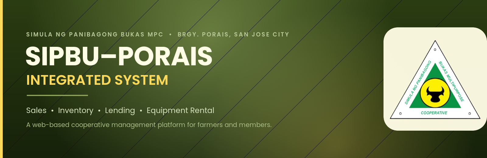
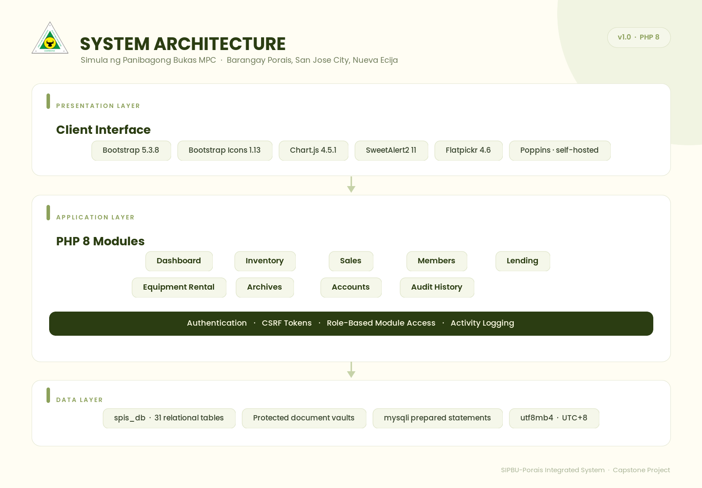

<div align="center">



# SIPBU-Porais Integrated System

### A Web-Based Management System with Integrated Sales, Inventory, Lending, and Equipment Rental

**For the Simula ng Panibagong Bukas Multipurpose Cooperative — Barangay Porais, San Jose City, Nueva Ecija**

<br>

[](https://www.php.net/)
[](https://mariadb.org/)
[](https://getbootstrap.com/)
[](https://www.chartjs.org/)

[](#)
[](LICENSE)
[](#roadmap)
[](https://en.wikipedia.org/wiki/Nueva_Ecija)

<sub>Cooperative Enterprise Management Platform · Published for reference purposes only (capstone defended)</sub>

</div>

> 🔒 **Private corporate system — reference only.** This repository is published publicly so the defended capstone project can be viewed and referenced. The system itself is private corporate property of the Simula ng Panibagong Bukas Multipurpose Cooperative (SIPBU-MPC). Viewing does not grant permission to copy, reuse, modify, or deploy the code. See [Copyright & Terms of Use](#copyright--terms-of-use) and [LICENSE](LICENSE).

---

## Table of Contents

- [About the Project](#about-the-project)
- [Core Features](#core-features)
- [System Modules](#system-modules)
- [System Architecture](#system-architecture)
- [Tech Stack](#tech-stack)
- [Access Control & User Roles](#access-control--user-roles)
- [Getting Started](#getting-started)
- [Demo Account](#demo-account)
- [Project Structure](#project-structure)
- [Database Overview](#database-overview)
- [Security Risk](#security-risk)
- [Security](#security)
- [Roadmap](#roadmap)
- [Copyright & Terms of Use](#copyright--terms-of-use)

---

## About the Project

The **SIPBU-Porais Integrated System (SPIS)** is a centralized, web-based management platform built for the daily operations of the **Simula ng Panibagong Bukas Multipurpose Cooperative (SIPBU-MPC)** in Barangay Porais, San Jose City, Nueva Ecija.

SIPBU is a cooperative of agrarian reform beneficiaries and dairy buffalo farmers. Before SPIS, records for product sales, farm supply inventory, member loans, and heavy equipment rentals were kept across separate ledgers and spreadsheets — leading to duplicated entries, hard-to-audit balances, and slow reporting come assembly time.

SPIS consolidates these operations into **one login, one database, and one source of truth**.

<table>
<tr>
<td width="50%" valign="top">

**The Problem**

- Fragmented records across handwritten ledgers and spreadsheets
- Loan balances and payments prone to manual computation errors
- No reliable equipment schedule → double-booked tractors and drivers
- Inventory levels were only discovered after a stockout
- Reporting for meetings took days of manual tallying
- No audit trail of who changed which record

</td>
<td width="50%" valign="top">

**The Solution**

- A single integrated database covering all cooperative enterprises
- Automated loan amortization, interest, and payment ledgers
- Live equipment availability with conflict checks per date
- Stock alerts and automatic quantity deduction per sale
- One-click, print-ready reports for every module
- Per-user module permissions and a complete activity history

</td>
</tr>
</table>

---

## Core Features

<table>
<tr>
<td width="33%" valign="top">

### 🔐 Secure Access
- Hashed passwords (`password_hash`)
- Session regeneration on login
- Failed-login throttling
- Forced password change on temporary credentials
- Per-module permission flags
- Live session revocation on password reset

</td>
<td width="33%" valign="top">

### 📊 Live Dashboard
- Sales trend and product distribution charts
- Inventory, member, and loan counters
- Pending and overdue lending alerts
- Low-stock / out-of-stock notifications
- Module-aware statistics per user

</td>
<td width="33%" valign="top">

### 🧾 Reports & Records
- Print-ready sales, loan, and rental reports
- Date-range filtering
- Ledger and payment histories
- Statement of account printouts
- Printable member and loan documents

</td>
</tr>
</table>

---

## System Modules

| Module | What it does |
| :--- | :--- |
| **Dashboard** | Consolidated operational snapshot: sales performance, stock health, member counts, lending exposure, and equipment utilization with interactive charts. |
| **Inventory** | Product catalog with acquisition cost, markup, and selling price. Tracks stock quantity, flags low/out-of-stock items on login, and preserves archived products for history. |
| **Sales** | Point-of-sale style recording with multi-item carts, member vs. non-member pricing, cash received and change computation, historical back-entry, and stock deduction on save. |
| **Members** | Cooperative member masterlist — personal information, farm profile (RSBSA, TIN, hectares), capital build-up (CBU) balances and history, plus secure document attachments. |
| **Lending** | Two loan products under one hub: **Monetary Loans** (cash with configurable interest rate and term) and **Product Loans** (goods released from inventory), each with approval workflow, payment recording, payment reversal, status history, and statement of account. |
| **Equipment Rental** | End-to-end scheduling of cooperative machinery: **Hauling**, **Rotor**, and **Reaper** service transactions, **tractor** registry with live availability, and **driver** assignment — all conflict-checked against the same calendar. |
| **Archives** | Soft-delete recovery center for accounts, members, drivers, tractors, products, and both loan types. Nothing is lost — records can be restored with full traceability. |
| **Accounts** | User administration: roles, module-level permissions, lending permission tier, activation status, and archival. |
| **Password Reset** | Authorized reset console that issues a temporary password and forces a change at next login. |
| **Audit History** | Immutable activity log of every create, update, archive, and restore — filterable by module, action, and user. |

---

## System Architecture

<div align="center">

</div>

SPIS follows a **classic three-layer architecture** on a LAMP-style stack, served as server-rendered PHP pages:

1. **Presentation Layer** — Semantic HTML rendered by PHP, styled with a custom olive-and-cream design system on top of Bootstrap 5, with self-hosted fonts and icon sets. No CDN dependency: the system runs fully offline inside the cooperative's local network.
2. **Application Layer** — PHP 8 modules, each a self-contained folder of pages, modals, handlers, and report generators. A shared `includes/check_access.php` guard enforces authentication, live permission refresh, and forced password rotation on every request.
3. **Data Layer** — A normalized MariaDB/MySQL schema (`spis_db`) with InnoDB tables, foreign-key relationships, and transactional writes for money-moving operations. Uploaded documents sit in directories that deny direct HTTP access, and are streamed only through authenticated handlers.

---

## Tech Stack

<table>
<tr><th align="left">Layer</th><th align="left">Technology</th><th align="left">Notes</th></tr>
<tr><td><b>Language</b></td><td>PHP 8.0+</td><td>Procedural core with strict input validation</td></tr>
<tr><td><b>Database</b></td><td>MariaDB 10.4+ / MySQL 8</td><td><code>spis_db</code>, InnoDB, <code>utf8mb4</code>, UTC+8</td></tr>
<tr><td><b>DB Access</b></td><td>MySQLi</td><td>Prepared statements throughout</td></tr>
<tr><td><b>UI Framework</b></td><td>Bootstrap 5.3.8</td><td>Self-hosted in <code>assets/</code></td></tr>
<tr><td><b>Icons</b></td><td>Bootstrap Icons 1.13.1</td><td>Local font bundle</td></tr>
<tr><td><b>Charts</b></td><td>Chart.js 4.5.1</td><td>Dashboard bar / line / pie visualizations</td></tr>
<tr><td><b>Alerts</b></td><td>SweetAlert2 11</td><td>Confirmations and system feedback</td></tr>
<tr><td><b>Date Pickers</b></td><td>Flatpickr 4.6.13</td><td>Rental scheduling and report filters</td></tr>
<tr><td><b>Typography</b></td><td>Poppins (self-hosted)</td><td>Regular / Medium / SemiBold / Bold</td></tr>
<tr><td><b>Server</b></td><td>Apache (XAMPP / WAMP)</td><td>Installed under <code>htdocs/spis</code></td></tr>
</table>

> **Design principle:** every third-party asset is vendored into the repository, so the system operates on a LAN with no internet connection.

---

## Access Control & User Roles

SPIS does not rely on a single "admin" flag. Each account carries **eight independent permission switches** plus a lending tier, evaluated live on every page load.

| Capability | Controlled by | Effect |
| :--- | :--- | :--- |
| Inventory access | `inventory_access` | Product catalog, pricing, stock |
| Sales access | `sales_access` | Sales recording, reports |
| Members access | `members_access` | Member masterlist, CBU, documents |
| Lending access | `lending_access` | Monetary & product loans |
| Rental access | `rental_access` | Hauling, rotor, reaper, tractors, drivers |
| Archives access | `archives_access` | Restore archived records |
| Accounts access | `account_access` | User administration |
| Password reset | `password_reset_access` | Issue temporary credentials |
| Lending tier | `lending_permission` | `Limited` or `Full` approval authority |

**Session hardening:** on every protected request the system re-reads the account from the database, rejects archived or inactive users, refreshes permissions, and compares a **password version hash** — so resetting a password instantly invalidates any other active session for that user.

---

## Getting Started

### Prerequisites

| Requirement | Minimum |
| :--- | :--- |
| Web server | Apache 2.4 (XAMPP / WAMP / Laragon) |
| PHP | 8.0 — with `mysqli` and `mbstring` |
| Database | MariaDB 10.4+ or MySQL 8 |
| Browser | Any modern Chromium, Firefox, or Safari |

### Installation

**1. Clone the repository into your server's web root**

```bash
cd C:/xampp/htdocs
git clone https://github.com/<owner>/SIPBU-Porais-Integrated-System-SPIS-.git spis
```

> 📌 **The folder must be named `spis`.** Module links, redirects, and asset paths are resolved against the `/spis/` base path.

**2. Import the database**

Open phpMyAdmin → **Import** → select `Database/spis database.sql` → **Go**.

This creates the `spis_db` schema, all 31 tables, relationships, and the demo dataset.

**3. Configure the connection**

Edit `db.php` and set your credentials:

```php
$host     = 'localhost';
$username = 'root';
$password = '';
$database = 'spis_db';
```

> ⚠️ Never commit real production credentials. See [SECURITY.md](SECURITY.md).

**4. Start Apache and MySQL**, then open:

```
http://localhost/spis/login.php
```

### Troubleshooting

| Symptom | Fix |
| :--- | :--- |
| *Unable to connect to the database.* | Start MySQL, verify the name/password in `db.php`, confirm `spis_db` was imported. |
| Styles or images missing | Folder is not named `spis`, or not directly under `htdocs`. |
| Redirected to login in a loop | `session.save_path` is not writable by Apache. |
| *Access Denied* after login | The account lacks the module flag — grant it in **Accounts**. |
| Forced to change password | Expected on temporary credentials; set a new password to continue. |

---

## Demo Account

A pre-seeded account is included for evaluation demonstrations:

| Field | Value |
| :--- | :--- |
| **Email** | `demo@spis.com` |
| **Password** | `123456` |
| **Role** | Manager |
| **Access** | All modules · Full lending permission |

<sub>Also recorded in <a href="Demo%20account%20to%20open%20the%20system.txt"><code>Demo account to open the system.txt</code></a>. Change or remove these credentials before any real deployment.</sub>

---

## Project Structure

```text
spis/
├── login.php                      · Authentication entry point
├── dashboard.php                  · Consolidated operational dashboard
├── db.php                         · Database connection (edit per machine)
├── change_password_required.php   · Forced password rotation
│
├── includes/
│   ├── check_access.php           · Authentication + permission guard
│   ├── history_logger.php         · Activity log writer
│   └── sidebar.php                · Shared navigation + stock alerts
│
├── inventory/                     · Product catalog and stock
├── sales/                         · Sales recording, export, reports
├── member/                        · Member profiles, CBU, documents
├── lending/
│   ├── monetary/                  · Cash loans, payments, statements
│   └── product/                   · Goods loans, items, payments
├── rental/
│   ├── hauling.php · rotor.php · reaper.php
│   ├── tractor/                   · Tractor registry & availability
│   ├── driver/                    · Driver registry & assignment
│   └── generate_*/                · Printable rental reports
├── archive/                       · Restore soft-deleted records
├── account/                       · Users, roles, password resets
├── history/                       · Audit trail viewer
│
├── css/                           · Module stylesheets
├── js/                            · Module scripts
├── assets/                        · Bootstrap, icons, fonts, charts, uploads
├── Database/
│   └── spis database.sql          · Full schema + demo data
└── docs/assets/                   · Documentation imagery
```

---

## Database Overview

The schema (`spis_db`) contains **31 tables** organized by domain:

| Domain | Tables |
| :--- | :--- |
| **Identity & Access** | `users`, `login_attempts`, `history_logs` |
| **Membership** | `members`, `member_attachments`, `member_cbu_transactions` |
| **Inventory & Sales** | `inventory`, `sales`, `sales_items` |
| **Lending — Monetary** | `monetary_loans`, `monetary_loan_payments`, `monetary_loan_attachments`, `monetary_loan_status_history` |
| **Lending — Product** | `product_loans`, `product_loan_items`, `product_loan_products`, `product_loan_payments`, `product_loan_attachments`, `product_loan_status_history` |
| **Rental Operations** | `tractors`, `drivers`, `hauling`, `hauling_payments`, `hauling_reschedules`, `hauling_driver_helpers`, `rotor`, `rotor_payments`, `rotor_price`, `reaper` |
| **Maintenance** | `monetary_demo_dates_backup`, `monetary_demo_dates_backup_20261022` — internal snapshot tables, safe to drop |

**Conventions**

- `utf8mb4` throughout, so the peso sign (₱) and Filipino names store correctly.
- `+08:00` enforced at both the PHP and MySQL session level — no timezone drift in reports.
- Monetary values use `DECIMAL` (never floats); totals are recomputed server-side.
- Archival is **soft**: `archived` flags and audit columns instead of hard deletes.
- Balance-affecting writes run inside transactions.

---

## Security Risk

> ⚠️ **Read before deploying.** SPIS handles member identities, loan ledgers, and cooperative finances. Misconfiguration can expose sensitive data or corrupt financial records.

| Risk | What can go wrong | Mitigation |
| :--- | :--- | :--- |
| **Demo credentials left unchanged** (`demo@spis.com`) | Anyone who finds this repository can log in with full access | Change or remove the demo account immediately after install; never deploy with default passwords |
| **Default `db.php` credentials** (`root` / empty password) | Database takeover if the server is exposed | Use a dedicated least-privilege database user; keep real credentials out of version control |
| **Plain HTTP on a LAN** | Session cookies and member data readable on the network | Serve over HTTPS, even inside the cooperative network |
| **Error display left on** | Database paths and query details leak to attackers | Set `display_errors = Off`, `log_errors = On` in production |
| **Publishing a production dump** | Real member PII (TIN, RSBSA, addresses, loan balances) becomes public | Never commit production data; the bundled SQL contains demo data only |
| **Unpatched server stack** | Known PHP / MariaDB / Apache vulnerabilities exploited | Keep XAMPP/WAMP components updated; review [SECURITY.md](SECURITY.md) quarterly |

Full controls, reporting channels, and hardening steps are documented in **[SECURITY.md](SECURITY.md)**.

---

## Security

SPIS handles member identities, loan ledgers, and financial records, so security is treated as a first-class feature:

- Strong password hashing via `password_hash()` (`PASSWORD_DEFAULT`) / `password_verify()`
- Prepared statements for all user-supplied queries
- CSRF tokens on every state-changing form
- Session ID regeneration on privilege change
- Login throttling with automatic lockout
- Password-version invalidation across devices
- Authenticated file streaming — upload directories deny direct access via `.htaccess`
- Security headers (`nosniff`, `SAMEORIGIN`, `no-store`, `same-origin` referrer policy)
- Server-side validation and permission re-checks on every request

> 🛡️ Found a vulnerability? Please read **[SECURITY.md](SECURITY.md)** and report it privately. Do not open a public issue.

---

## Roadmap

- [x] Authentication, roles, and module-level permissions
- [x] Inventory, Sales, Members, and CBU tracking
- [x] Monetary and Product lending with ledgers
- [x] Equipment rental with conflict-aware scheduling
- [x] Archives, audit history, and printable reports
- [ ] PDF export engine for official statements
- [ ] SMS / email notifications for due loans
- [ ] Offline-first PWA shell for field encoding
- [ ] Automated database backup scheduler
- [ ] Financial analytics for the board (cooperative-wide profitability)

---

## Copyright & Terms of Use

```text
Copyright (c) 2026 Simula ng Panibagong Bukas Multipurpose Cooperative (SIPBU-MPC)
All rights reserved.
```

This is a **private corporate system**. The repository is public for **reference and viewing purposes only** (capstone defended project reference). Viewing the code does not grant permission to:

- copy, reuse, modify, or redistribute the source code, database schema, or documentation;
- deploy the system for any other cooperative, company, or organization;
- claim the work as your own.

All reuse requires **prior written permission** from SIPBU-MPC. See [LICENSE](LICENSE) for the full terms. Third-party libraries bundled in `assets/` remain under their own open-source licenses.

---

<div align="center">
<br>

**[⬆ Back to top](#sipbu-porais-integrated-system)**

<sub>Built with care for the farmers of Barangay Porais, San Jose City, Nueva Ecija 🇵🇭</sub>

</div>
