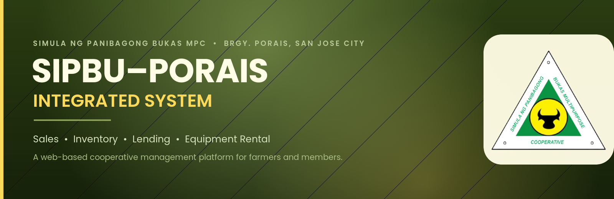

# Security Policy

**SIPBU-Porais Integrated System (SPIS)**

*Handling member identities, loan ledgers, and cooperative finances — responsibly.*

---

## Security Risk — Read Before Deploying

> ⚠️ **Private corporate system.** SPIS stores member identities, loan ledgers, and cooperative finances. The most common causes of compromise are not code bugs but deployment mistakes:

| Risk | Impact | Required action |
| :--- | :--- | :--- |
| Demo account (`demo@spis.com` / `123456`) left active | Full system access for anyone who finds this public repository | Change or delete immediately after installation |
| `db.php` still uses `root` with an empty password | Database compromise if the host is reachable | Create a dedicated user with only `spis_db` privileges |
| No HTTPS, even on the LAN | Session hijacking and credential theft | Enable TLS; set secure session cookie flags |
| `display_errors` left on | Internal paths and SQL errors disclosed | Disable in production; log errors server-side only |
| Production data committed to Git | Permanent public exposure of member PII and balances | Never commit dumps, uploads, or `.env` files — see `.gitignore` |
| Stale PHP / MariaDB / Apache | Exploitation of known vulnerabilities | Patch the stack on a schedule; monitor `history_logs` and `login_attempts` |

See [Deployment Hardening](#deployment-hardening) below for the full checklist.

---

## Supported Versions

Security fixes are applied to the latest release line. Older builds are not maintained.

| Version | Supported | Notes |
| :---: | :---: | :--- |
| **1.0.x** | ✅ | Current release — actively patched |
| < 1.0 | ❌ | Pre-release development builds |
| Forked or modified deployments | ⚠️ | Supported only by the party that modified them |

> Because SPIS is deployed on a local cooperative network, **the security of your installation also depends on your server configuration** — see [Deployment Hardening](#deployment-hardening) below.

---

## Reporting a Vulnerability

**Please do not open a public issue, pull request, discussion, or social media post for a security problem.**

### Preferred channel — GitHub Private Advisory

1. Open the repository's **[Security tab](https://github.com/<owner>/SIPBU-Porais-Integrated-System-SPIS-/security)**
2. Choose **Report a vulnerability**
3. Describe the issue privately to the maintainers

### What to include

| Detail | Example |
| :--- | :--- |
| **Summary** | One-line description of the weakness |
| **Affected area** | Module and file, e.g. `sales/save_sales.php` |
| **Reproduction steps** | Minimal, numbered steps to trigger it |
| **Impact** | What an attacker could read, change, or destroy |
| **Environment** | PHP version, database, browser, deployment setup |
| **Evidence** | Screenshots, request/response samples, or a proof of concept |
| **Suggested fix** | Optional, but always appreciated |

> 🔒 Never include real member data, live credentials, or database dumps in a report. Use synthetic examples.

---

## Response Timeline

| Stage | Target |
| :--- | :--- |
| Acknowledgement of report | Within **3 business days** |
| Initial assessment & severity triage | Within **7 business days** |
| Fix developed and verified | Within **30 days** for high/critical issues |
| Public disclosure | After a fix is released, coordinated with the reporter |

You will be kept informed at each stage. If a report is **declined**, you will receive the reasoning and any relevant mitigating guidance.

### Severity guide

| Level | Examples |
| :--- | :--- |
| **Critical** | Authentication bypass, SQL injection, remote code execution, exposed loan/financial ledgers |
| **High** | Privilege escalation between modules, CSRF enabling unauthorized money movement, arbitrary file read/write |
| **Medium** | Stored XSS, session fixation, insecure direct object reference on member documents |
| **Low** | Information leakage in error messages, missing hardening headers, clickjacking on low-risk pages |

---

## Scope

### ✅ In scope

- Authentication, session handling, and password reset flows
- Authorization and module-level permission enforcement
- SQL injection and data-integrity issues
- CSRF, XSS, and file-upload / file-serving weaknesses
- Exposure of member records, loan ledgers, or uploaded documents
- Business-logic flaws affecting balances, interest, or stock quantities
- Sensitive information committed to the repository

### ❌ Out of scope

- Vulnerabilities in third-party libraries already fixed upstream (report those upstream, and let us know)
- Issues requiring physical access to an unlocked, logged-in workstation
- Missing security features that are documented as planned in the [Roadmap](README.md#roadmap)
- Social engineering of cooperative staff
- Denial of service through resource exhaustion on a local network
- Reports generated solely by automated scanners without a demonstrated impact

---

## Security Measures in SPIS

The following controls are already implemented. Reports that bypass any of them are especially valuable.

| Area | Implementation |
| :--- | :--- |
| **Password storage** | `password_hash()` with `PASSWORD_DEFAULT` (bcrypt on PHP 8.0); verified with `password_verify()` — never plain text, never MD5 |
| **Query safety** | MySQLi prepared statements with bound parameters across all modules |
| **CSRF protection** | Per-session tokens validated with `hash_equals()` on state-changing requests |
| **Session integrity** | ID regeneration after login; live account re-validation on every protected request |
| **Credential rotation** | Password-version hash stored in session — a reset instantly invalidates other active sessions |
| **Brute-force resistance** | Failed attempts recorded in `login_attempts` with timed lockout |
| **Forced rotation** | `must_change_password` forces a new password before any module opens |
| **Authorization** | Eight independent module flags + lending tier, re-read from the database per request |
| **File protection** | Upload directories (`assets/members`, `assets/documents/*`) block direct access via `.htaccess`; files stream through authenticated handlers |
| **Soft deletion** | Archival instead of destructive deletes, preserving auditability |
| **Data integrity** | `DECIMAL` for all money, server-side recomputation of totals, transactions for balance operations |
| **Audit trail** | Every create, update, archive, and restore written to `history_logs` with user and role |
| **Headers** | `X-Content-Type-Options: nosniff`, `X-Frame-Options: SAMEORIGIN`, `Referrer-Policy: same-origin`, `Cache-Control: no-store` |
| **Encoding** | `utf8mb4` end to end; output escaped on render |
| **Dependency posture** | All front-end libraries vendored locally — no CDN, no runtime supply-chain fetch |

---

## Deployment Hardening

SPIS ships configured for **local development** (XAMPP defaults). Before real cooperative use:

1. **Change every default credential.** Remove or re-password the demo account (`demo@spis.com`) immediately.
2. **Use a dedicated database user.** Do not run the application as `root`; grant only the privileges it needs on `spis_db`.
3. **Keep `db.php` out of version control** in production; inject credentials via environment or a server-side config outside the web root.
4. **Disable error display.** Set `display_errors = Off` and `log_errors = On` in `php.ini`.
5. **Serve over HTTPS.** Even on a LAN, protect session cookies in transit.
6. **Harden session cookies.** Use `session.cookie_httponly`, `session.cookie_samesite = Lax`, and `session.use_strict_mode = 1`.
7. **Restrict the archives and upload folders** at the web-server level, and verify `.htaccess` overrides are actually enabled (`AllowOverride All`).
8. **Back up `spis_db` on a schedule** and store backups encrypted, off the application server.
9. **Review module permissions** quarterly — grant the least access each staff role needs.
10. **Monitor `history_logs` and `login_attempts`** for unexpected activity.

---

## Handling of Personal Data

SPIS stores names, addresses, birth dates, contact numbers, TIN, RSBSA numbers, and farm profiles of cooperative members, along with loan and payment records.

- Collect only what the cooperative genuinely needs to serve its members.
- Restrict access to the minimum set of staff through module permissions.
- Never publish a production dump to this repository, a chat group, or a class submission.
- Retain records only as long as cooperative policy and Philippine data privacy rules require.
- The bundled `Database/spis database.sql` contains **sample/demo data only** and must remain that way.

---

## Disclosure Policy

We follow **coordinated disclosure**: the issue is investigated and fixed privately, a patched release is published, and only then is the vulnerability described publicly — with credit to the reporter if they wish.

Thank you for helping keep SIPBU's members and their records safe.

 

**[⬆ Back to README](README.md)** · **[License](LICENSE)**

© 2026 Simula ng Panibagong Bukas Multipurpose Cooperative (SIPBU-MPC) · All rights reserved · Private corporate system — reference only

